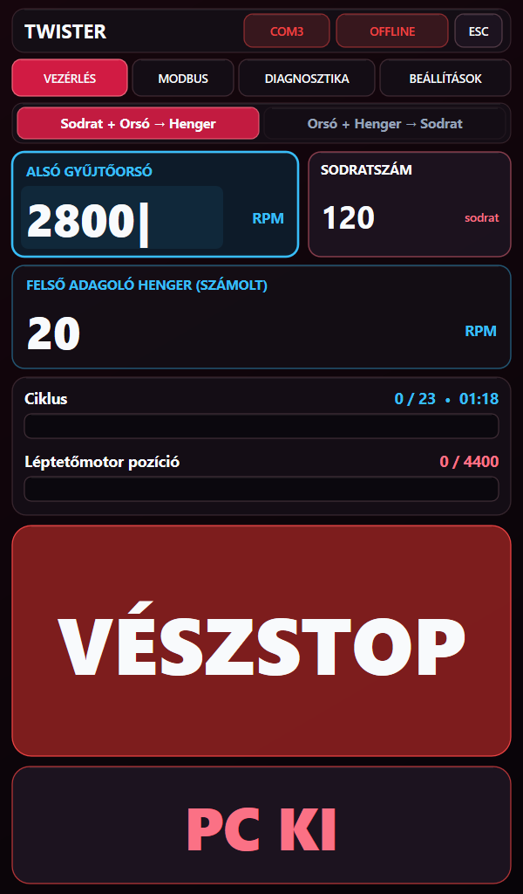
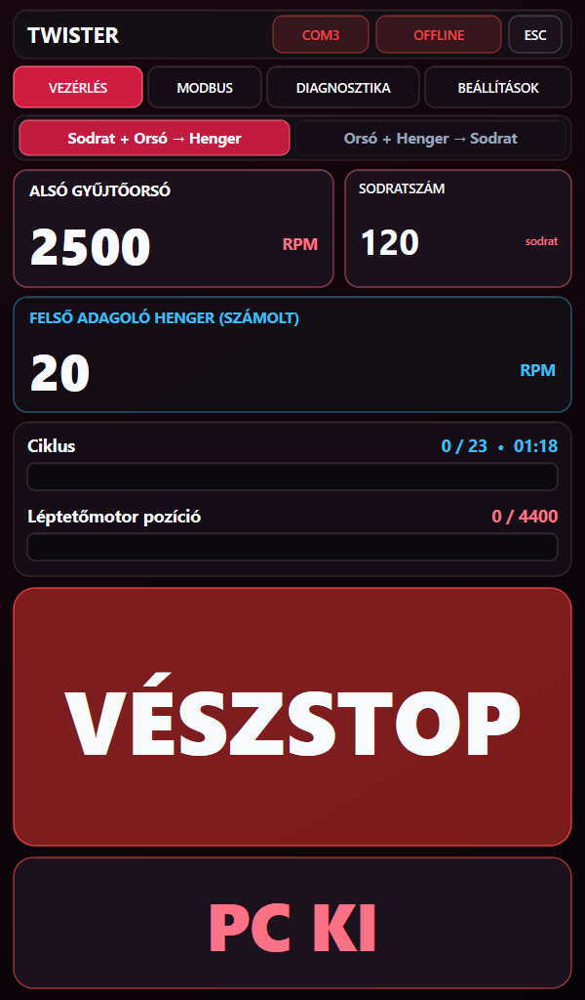
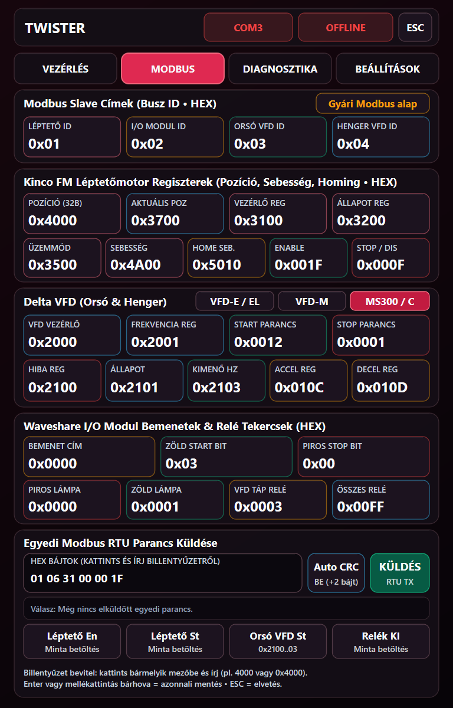
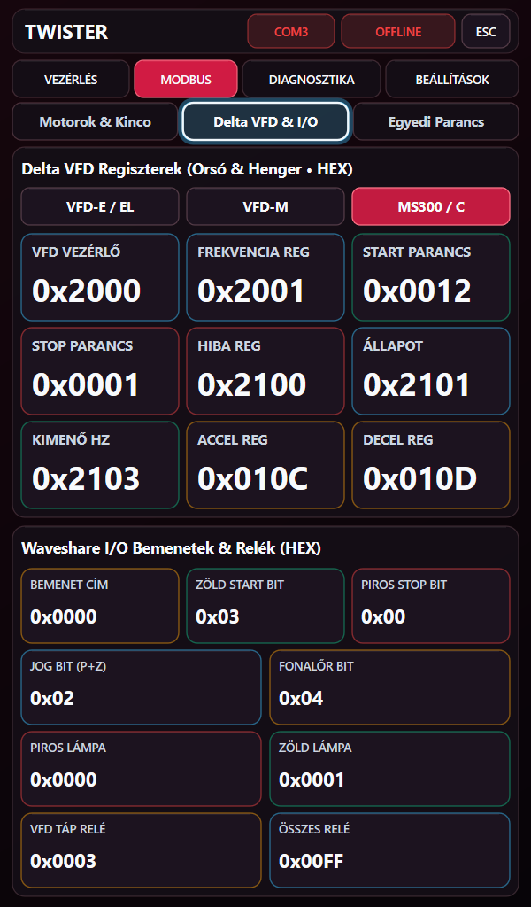
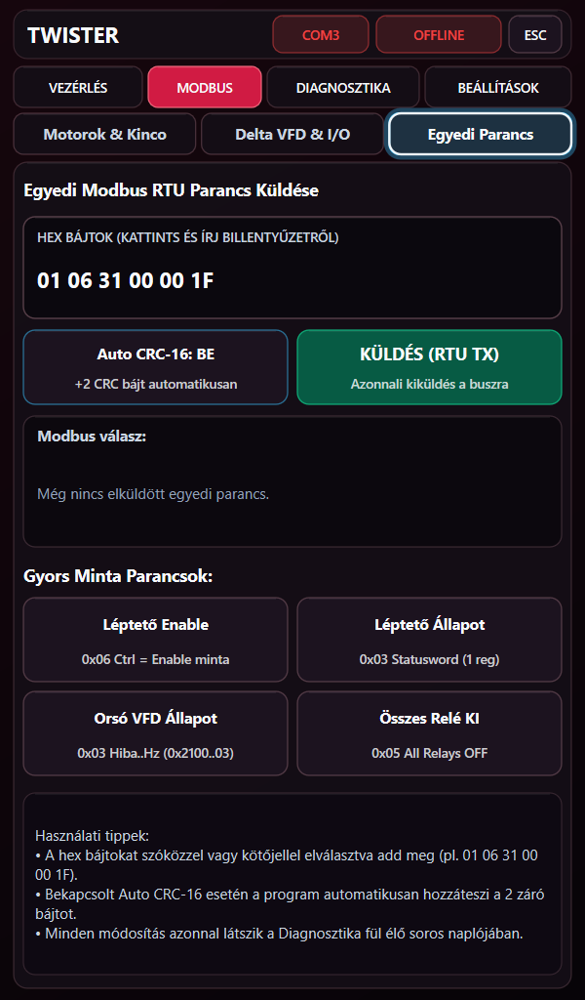
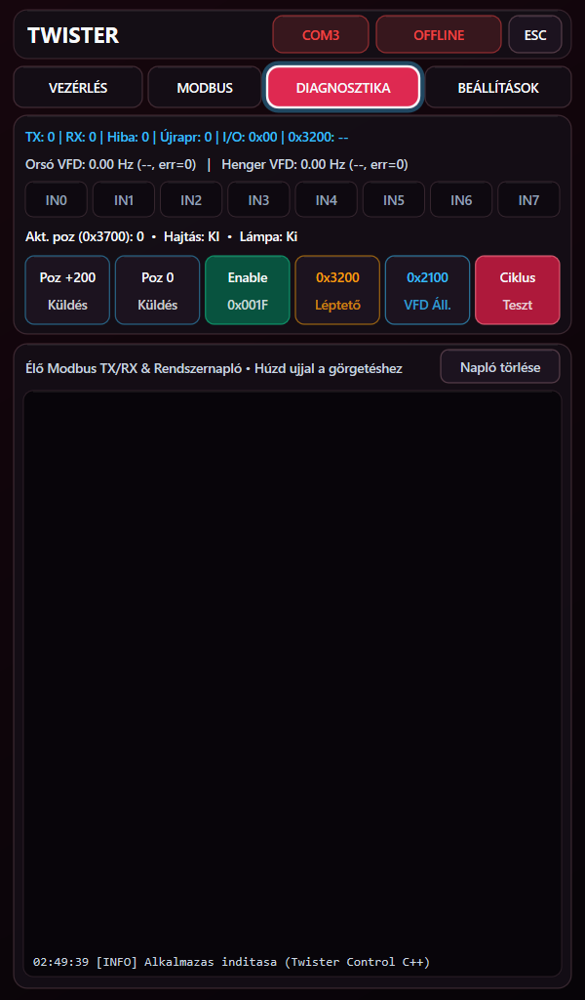
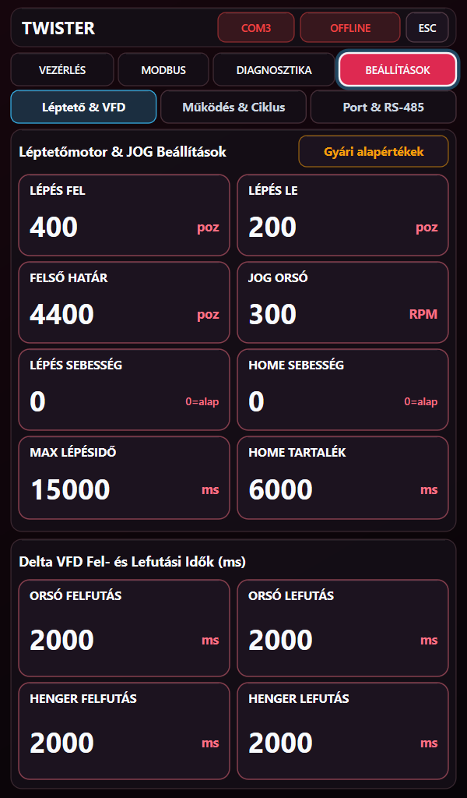
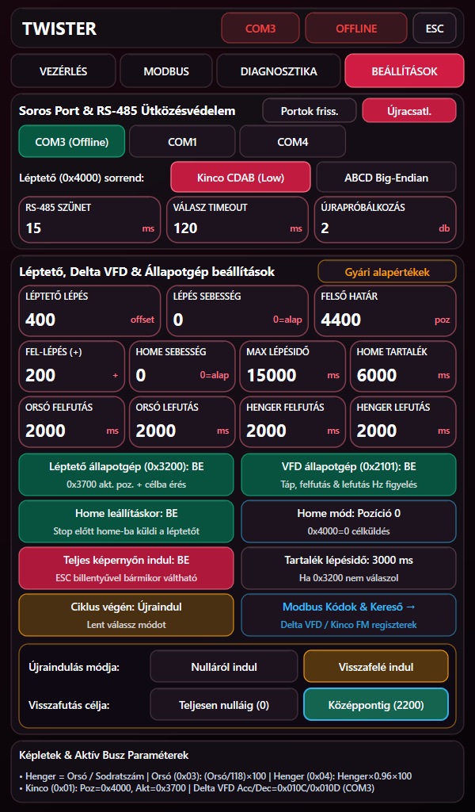
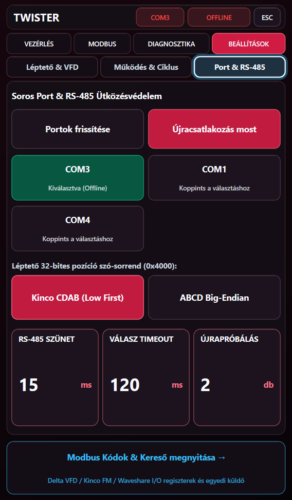

# Twister Control — Részletes Kezelői Kézikönyv

Ez a program a fonalsodró gép teljes vezérlőszoftvere érintőképernyőre (`1024×600`-as álló (`600×1024`) kijelzőre) és normál egér + billentyűzet használatra tervezve.  
A PC egyetlen RS-485 soros kábelen keresztül (`COM3`, `19200 bps`, `8N1`) egyszerre 4 eszközt irányít:
1. **`0x01` — Kinco FM léptetőmotor-hajtás** (a fonálvezető szán fel-le mozgatása)
2. **`0x02` — I/O relémodul** (fizikai Start/Stop gombok olvasása + jelzőlámpák és főkontaktor kapcsolása)
3. **`0x03` — Delta VFD frekvenciaváltó** (alsó gyűjtőorsó villanymotor)
4. **`0x04` — Delta VFD frekvenciaváltó** (felső fonaladagoló henger villanymotor)

---

## 1. Alapvető használat (Indítás, mentés, számok átírása)

### Indítás és ablakkijelzés
- **Program indítása:** Magától elindul a gép indulásakor, esetleg frissülhet. Semmit sem kell telepíteni.
- **Teljes képernyő ↔ Ablak váltás:** Alapértelmezetten teljes képernyőn indul. Az **`ESC`** billentyűvel (vagy a jobb felső sarokban lévő `ESC` / `FULL` gombbal) bármikor válthatsz ablakos és teljes képernyős mód között *(kivéve ha épp egy szövegdobozba írsz — akkor az első `ESC` kilép a dobozból, a második `ESC` vált ablakmódot)*.
- **Automatikus mentés és napló:**
  - Minden módosítás automatikusan elmentődik a program melletti **`twister_config.ini`** fájlba. Ha újraindítod a programot, minden beállításod pontosan úgy marad, ahogy hagytad.
  - Ha van a régi C# programból megmaradt `config.txt` fájlod az `.exe` mellett, az első indításkor a program automatikusan átolvassa belőle a régi adatokat. *`(amúgy én erre nem alapoznék, szóval jobb ha ki van törölve a régi config.txt és utána megnyitva első indításnál, mert meglehet hogy minden alkalommal újratölti a régi beállításokat onnan, illetve ennek a programnak a kiindulási alapja még egy régesrégi verzió az eredeti c# programról c++-ra teljesen előről újraírva szólva tényleg ne.)`*
  - Minden működési lépés és hiba bekerül a **`debug.txt`** fájlba.

### Hogyan kell értékeket (számokat és kódokat) módosítani?
Nincs felugró képernyő-billentyűzet — közvetlenül a rendes billentyűzetről tudsz írni:
1. **Kattints bele abba a dobozba**, amit át akarsz írni. A doboz kerete **világoskékre vált**, a régi szám kijelölődik, és megjelenik a végén a `|` kurzor.
2. **Írd be az új értéket:**
   - Ha rögtön elkezdesz gépelni, az első leütés felülírja a régi számot.
   - Ha a **`Backspace`**-t nyomod meg (vagy még egyszer belekattintasz az aktív dobozba), karakterenként törölhetsz és javíthatsz.
3. **Mentéshez két lehetőséged van:**
   - Nyomd meg az **`Enter`** billentyűt, **VAGY**
   - **Kattints bárhová máshová a képernyőn** (egy másik dobozra, másik fülre vagy az üres háttérre).
   - Mindkét esetben **álló gépnél** a program azonnal elmenti az új értéket a fájlba, újraszámolja a függő értékeket és kilép a szerkesztésből.
   - **Futó program közben** ugyanúgy átírhatsz bármilyen értéket és opciót — ilyenkor a felső sávban sárga **`ZÖLD = KÜLDÉS`** jelzés jelenik meg, és a gép biztonságosan megvárja a fizikai **Zöld gomb** megnyomását (amely RS-485 ütközés nélkül küldi ki és menti el az összes módosítást a futó gépre).
4. **Mégse (`ESC`):** Ha írás közben **`ESC`**-et nyomsz, elveti a félbehagyott gépelést, és visszaáll a korábbi érték.

### Egyszerűsített billentyűzetes navigáció (`Numpad 8 / 2 / 4 / 6 + Enter`)
Érintőképernyő és egér mellett **mindig működik** a gyors irányított navigáció (akkor is, ha a NumLock be vagy ki van kapcsolva, vagy sima nyílbillentyűket használsz):
- **`Numpad 8` (`↑`):** Lépés felfelé a következő gombra / mezőre / fülre.
- **`Numpad 2` (`↓`):** Lépés lefelé.
- **`Numpad 4` (`←`):** Lépés balra a sorban.
- **`Numpad 6` (`→`):** Lépés jobbra a sorban.
- **`Enter`:** Megnyomja a fehér-kék kerettel kijelölt gombot, átváltja a fület, vagy megnyitja a kijelölt paraméter szerkesztését.
- **Érték beírása közben nincs ütközés:** amint **`Enter`**-rel (vagy érintéssel) beléptél egy számmezőbe, a **`Numpad 8 / 2 / 4 / 6`** normál számjegyként gépelődik be, az **`Enter`** elmenti és kilép, utána pedig rögtön újra navigálhatsz vele! *(A `PC KI` ablak megnyitásakor az alapértelmezett fókusz biztonságból mindig a `MÉGSE` gombon áll.)*

---

## 2. A felső állapotsor (minden oldalon ugyanott látható)

| Elem | Mit mutat / Mit csinál ha rákattintasz? |
| :--- | :--- |
| **`TWISTER`** | A program neve. |
| **`COM3`** *(port gomb)* | Zöld, ha a soros port sikeresen csatlakozva van; piros, ha nem érhető el. Rákattintva rögtön a **`BEÁLLÍTÁSOK → Port & RS-485`** aloldalra ugrik, ahol portot választhatsz. |
| **`ZÖLD = KÜLDÉS`** *(sárga jelző)* | Csak akkor jelenik meg, ha **futó program közben** módosítottál valamit a képernyőn. A fizikai **Zöld gomb** megnyomásáig várakozik a változtatások biztonságos kiküldésével. |
| **Állapotjelző doboz** | A gép pillanatnyi állapota: • **`OFFLINE`** (piros): nincs nyitott soros port • **`KÉSZENLÉT`** (sárga): áll a gép, várja az indítást • **`INDÍTÁS...`** (sárga): relék ellenőrzése/kapcsolása, frekiváltók bebootolása és felpörgése • **`ÜZEMEL`** (zöld) / **`JÓVÁHAGYÁS?`** (sárga) / **`JÓVÁHAGYVA`** (zöld) / **`VÉGÉN LEÁLL`** (rózsaszín): forognak a motorok és megy a léptetőmotor-ciklus; **`Jóváhagyással`** módban a program vége előtti beállított időnél (`VILLOGÁS ELŐTTE`, alap `5 perc`) **`JÓVÁHAGYÁS?`** látható és villog a zöld lámpa • **`JOG MÓD`** (kék): Piros + Zöld hosszú nyomva tartásával aktív lassú kézi/ellenőrző járatás • **`LEÁLLÍTÁS`** (piros): motorok leállítása és léptető Home-ba küldése • **`HIBA`** (piros): hiba történt (pl. port vagy meghajtó hiba — részletek a `DIAGNOSZTIKA` naplóban) |
| **`ESC` / `FULL` gomb** | Vált teljes képernyős és ablakos mód között (ugyanazt csinálja, mint az `ESC` billentyű). |
| **4 fő oldalválasztó fül** | **`VEZÉRLÉS`** • **`MODBUS`** • **`DIAGNOSZTIKA`** • **`BEÁLLÍTÁSOK`** — rákattintva azonnal oldalt vált (ha épp írtál egy mezőbe, előtte elmenti). |

---

## 3. Hogyan indul és áll le a gép a fizikai gombokkal?

A program folyamatosan figyeli a gép **`0x02`** I/O modulján lévő fizikai Start és Stop gombokat:

### Zöld gomb (`Start / Módosítás küldés`) megnyomása:
* **Ha áll a gép (`KÉSZENLÉT`):**
  1. Kikapcsolja a piros jelzőlámpát (`0x0000`), felkapcsolja a zöld jelzőlámpát (`0x0001`).
  2. **Ellenőrzi (`FC 0x01`)**, hogy a frekiváltók főkontaktora (`0x0003`) be van-e már kapcsolva: ha még ki van kapcsolva, bekapcsolja és megvárja a frekiváltók felállását; ha már áram alatt van, azonnal tovább lép.
  3. **Ellenőrzi a két Delta frekiváltó hibamentes készenlétét** (`0x2100/0x2101`).
  4. Beírja a beállított felfutási és lefutási időket (ha `> 0 ms`), elküldi a kiszámolt célfrekvenciákat (`0x2001`), majd kiadja az indítás parancsot (`0x2000 = 0x0012`).
  5. **Megvárja, míg mindkét motor ténylegesen felpörög** a célfrekvenciára (`0x2103`).
  6. Csak ezután indítja el a Kinco léptetőmotor ciklusát (`0`-tól `4400` felé).
* **Ha fut a program (`ÜZEMEL` / `JÓVÁHAGYÁS?` villogás):**
  - **Menet közbeni változtatások kiküldése:** ha menet közben átírtál fordulatszámot, sodratot, felfutást, léptetőt vagy bármely beállítást, a Zöld gomb egy rövid megnyomása elmenti és RS-485 ütközés nélkül rögtön kiküldi a változtatásokat a futó gépre.
  - **Ciklus folytatásának jóváhagyása / elutasítása (`Jóváhagyással` mód):**
    - Ha a **`BEÁLLÍTÁSOK → Működés & Ciklus`** aloldalon a `Ciklus végén:` beállítás **`Jóváhagyással`** állásban van, akkor amikor már kevesebb mint a **`VILLOGÁS ELŐTTE`** mezőben megadott perc *(alap: `5 perc`)* van hátra a menetből, a **zöld lámpa villogni kezd** (`JÓVÁHAGYÁS?`). *(Más `Ciklus végén` módokban — `Leáll (1:1)` és `Újraindul` — nem villog.)*
    - **Következő ciklus jóváhagyása:** villogás közben a fizikai **Zöld gomb** megnyomásával hagyod jóvá, hogy a menet végén automatikusan elinduljon a következő ciklus (`JÓVÁHAGYVA`). Ezzel egyidőben a villogás megáll, a zöld lámpa folyamatosan világít, és az esetleges módosításokat is kiküldi.
    - **Következő ciklus elutasítása (`-` billentyű):** ha a billentyűzeten megnyomod a **`-`** *(mínusz)* gombot *(kizárólag akkor, ha nem vagy szövegdoboz szerkesztésében és nincs nyitott megerősítő ablak)*, a gép elutasítja az újraindulást (`VÉGÉN LEÁLL`), a villogás megáll (folyamatosan zöld), majd az aktuális menet végén biztonságosan leáll.
    - **Ha nem érkezik válasz a menet végéig:** ha megállásig villog a zöld és nem kaptál vissza visszajelzést, a gép biztonságból szintén leáll és Home-ba áll.

### Piros + Zöld gomb egyszerre hosszan nyomva (`JOG mód`, `0x02`):
A két fizikai nyomógomb együttes, kb. 0,6 másodperces nyomva tartásával aktiválható (beépített védelemmel, hogy a nyomógombok pár tizedmásodperces eltéréssel történő megnyomása vagy elengedése véletlenül se állítsa le a gépet):
* **Amikor FUT a program:**
  - **Mindkét jelzőlámpa (`Piros` + `Zöld`) egyszerre világít.**
  - Az alsó gyűjtőorsó belassul a **`JOG ORSÓ`** beállítás szerinti fordulatra (alap: `300 RPM`), a felső adagoló hengert pedig az aktuális **sodratszámmal arányosan** automatikusan hozzá számolja és lelassítja.
  - A léptetőmotor sebessége visszakapcsol az alap sebességre (`0x4A00` gyári/alap értékére).
  - **Amint elengeded** a gombokat, a piros lámpa kialszik, minden motor arányosan **visszapörög** az üzemi fordulatra és a program pontosan onnan folytatódik tovább!
* **Amikor NEM megy program (`KÉSZENLÉT`):**
  - **Mindkét lámpa (`Piros` + `Zöld`) egyszerre világít.**
  - Ellenőrzi (`FC 0x01`), be van-e kapcsolva a VFD tápkontaktor (`0x0003` — ha szükséges, bekapcsolja), majd **csakis az alsó gyűjtőorsó** forog a `JOG ORSÓ` (`300 RPM`) fordulaton, amíg a két gombot tartod. Elengedésre megáll, és visszaáll készenlétbe (piros lámpa).

### Piros gomb (`Stop`) megnyomása:
1. Azonnal kiadja a leállítás parancsot mindkét Delta frekiváltónak (`0x2000 = 0x0001`).
2. Ha a **`Home leállításkor: BE`** be van kapcsolva, visszaküldi a léptetőmotort a kiinduló pontba (**Home**) a megadott **`HOME SEBESSÉG`** értékkel, és megvárja, míg odaér. Ezután letiltja a léptető hajtást.
3. **Megvárja, míg mindkét Delta frekiváltó ténylegesen megáll (`0 Hz`, `Stop` állapot)** — így a zöld lámpa mindaddig világít, amíg az orsók ténylegesen forognak.
4. Ha minden megállt: zöld lámpa KI, piros lámpa BE, a gép **`KÉSZENLÉT`**-be áll.

---

## 4. Oldalankénti részletes leírás — Minden gomb és mező

---

### 1. oldal: `VEZÉRLÉS` *(Főoldal napi gyártáshoz)*

Ez az oldal szándékosan letisztult, nagy feliratokkal és kevés gombbal, hogy üzemi környezetben is tévedésmentesen lehessen kezelni.

#### A) Számítási mód váltó (legfelső két gomb)
A három fonalparaméter közül kettőt te adsz meg, a harmadikat a gép áttételeiből automatikusan számolja a program:
* **`Sodrat + Orsó → Henger`** *(aktív = piros)*:
  - Te írod be az **`ALSÓ GYŰJTŐORSÓ`** fordulatszámát és a **`SODRATSZÁM`**-ot.
  - A gép kiszámolja a **`FELSŐ ADAGOLÓ HENGER (SZÁMOLT)`** értékét:
    $$\text{Henger RPM} = \text{Orsó RPM} / \text{Sodratszám}$$ *(egész osztás, pl. `2500 / 120 = 20 RPM`)*
* **`Orsó + Henger → Sodrat`**:
  - Te írod be az **`ALSÓ GYŰJTŐORSÓ`** és a **`FELSŐ ADAGOLÓ HENGER`** fordulatszámát.
  - A gép kiszámolja a **`SODRAT (SZÁMOLT)`** értékét:
    $$\text{Sodratszám} = \text{Orsó RPM} / \text{Henger RPM}$$

#### B) A 3 nagy paraméterdoboz
* **`ALSÓ GYŰJTŐORSÓ` (`RPM`):** Mindig szerkeszthető. Ebből számolja a frekiváltó parancsot is: `((Orsó / 118) × 100)` (`0,01 Hz`-es egységben, pl. `2500 → 2100 = 21,00 Hz`).
* **`SODRATSZÁM` (`sodrat`)** *(vagy `SODRAT (SZÁMOLT)`)*: Ha a bal oldali mód aktív, rózsaszín keretes és kattintva szerkeszthető; ha a jobb oldali mód aktív, világoskék keretes (csak kijelző, a program számolja).
* **`FELSŐ ADAGOLÓ HENGER` (`RPM`)** *(vagy `(SZÁMOLT)`)*: Jobb oldali módban szerkeszthető; bal oldali módban automatikusan számolt (`Henger × 0,96 × 100`, pl. `20 → 1920 = 19,20 Hz`).

#### C) A két folyamatjelző sáv (középen)
* **`Ciklus` sáv** (`pl. 0 / 23  •  01:18`):
  - A szám azt mutatja: **hány lépés teljesült / hány lépésből áll az aktuális menet**.
  - Mellette az **`MM:SS`** formátumú idő a **várható hátralévő idő** (indításnál is látod előre, mennyit fog menni a program, futás közben pedig folyamatosan, egyenletesen csökkenve pontosodik a mért léptetési sebességhez — sosem ugrál össze-vissza!).
* **`Léptetőmotor pozíció` sáv** (`pl. 0 / 4400`):
  - A szán aktuális helyzetét mutatja a **`0`** és a **`FELSŐ HATÁR`** (`4400`) között, **mínusz előjel nélkül** *(a háttérben továbbra is negatív számmal számol a Kinco vezérlőnek, de a kijelzőn mindig tisztán, előjel nélkül jelenik meg)*.
  - Ha `0x3700` valós pozíció-kiolvasás válaszol, pontosan a motor tényleges elmozdulását követi; visszafelé tekercselésnél pedig lefelé csökken a sáv.

#### D) A két óriás biztonsági gomb (alul)
* **`VÉSZSTOP`** *(óriás piros gomb)*:
  - Bármikor azonnal megszakít minden folyamatot:
    1. Egy paranccsal **lekapcsolja az összes relét** (`02 05 00 FF 00 00`) — elmegy a kontaktor táp és minden lámpa.
    2. **Helyben megállítja** a léptetőmotort (`0x3100 = 0x000F`) — **NEM indítja el Home-ba** (nehogy visszafelé mozdulva kárt tegyen!).
    3. Leállítja mindkét frekiváltót (`0x2000 = 0x0001`).
* **`PC KI`** *(alsó sötétpiros gomb)*:
  - Megnyit egy megerősítő ablakot (`GÉP ÉS PC LEÁLLÍTÁSA`), hogy véletlen érintésre ne kapcsoljon ki:
    - **`MÉGSE (ESC)`:** Bezárja az ablakot, nem történik semmi.
    - **`IGEN, LEÁLLÍTÁS`:** Lefuttatja a Vészstop relé-lekapcsolást, vár 1 másodpercet, majd azonnal leállítja a Windows számítógépet (`shutdown /s /t 0`).

---

### 2. oldal: `MODBUS` *(3 tágas aloldalra bontva)*

Itt van összegyűjtve a gép összes Modbus-kódja **HEX** (hexadecimális) formában. A jobb olvashatóság és könnyű érintés érdekében 3 aloldalra van osztva:

#### Aloldal 1: `Motorok & Kinco`

Bármelyik mezőre kattintva közvetlenül átírhatod billentyűzetről (pl. `3100` vagy `0x3100` is működik, `Enter` vagy mezőn kívüli koppintás menti).

* **`Modbus Slave Címek (HEX)`:**
  - **`LÉPTETŐ ID`** (alap: `0x01`): A Kinco FM léptetőmotor-hajtás buszcíme.
  - **`I/O MODUL ID`** (alap: `0x02`): A Waveshare 8 csatornás gomb/relé modul buszcíme.
  - **`ORSÓ VFD ID`** (alap: `0x03`): Az alsó gyűjtőorsót hajtó Delta frekiváltó címe.
  - **`HENGER VFD ID`** (alap: `0x04`): A felső adagoló hengert hajtó Delta frekiváltó címe.
  - **`Gyári Modbus alap` gomb** *(narancs gomb)*: Visszaállítja az összes Modbus címet és kódot az eredeti alapértékre.
* **`Kinco FM Léptetőmotor Regiszterek (HEX)` (`3×3` nagy gomb):**
  - **`POZÍCIÓ (32B)`** (`0x4000`): Célpozíció (32 bites szám).
  - **`AKTUÁLIS POZ`** (`0x3700`): Valós idejű aktuális pozíció kiolvasása.
  - **`VEZÉRLŐ REG`** (`0x3100`): Vezérlőregiszter (indítás / megállítás).
  - **`ÁLLAPOT REG`** (`0x3200`): Statusword (célba érés, mozgás, hiba).
  - **`ÜZEMMÓD`** (`0x3500`): Pozíció mód (`1`) és Homing mód (`6`) közti váltás.
  - **`SEBESSÉG`** (`0x4A00`): A munka közbeni mozgási sebesség regisztere.
  - **`HOME SEB.`** (`0x5010`): Homing keresési sebesség (CiA-402 módban).
  - **`ENABLE`** (`0x001F`): Parancsszó a mozgás indításához.
  - **`STOP / DIS`** (`0x000F`): Parancsszó a léptető megállításához.

#### Aloldal 2: `Delta VFD & I/O`

* **`Delta VFD Regiszterek (Orsó & Henger • HEX)`:**
  - **Gyorsválasztó gombok a fejléc alatt** *(kiválasztott = piros)*:
    - **`VFD-E / EL`**: Beállítja az `ACCEL REG = 0x0109` és `DECEL REG = 0x010A` címeket (`Pr.01.09 / 01.10`).
    - **`VFD-M`**: Beállítja az `ACCEL REG = 0x010A` és `DECEL REG = 0x010B` címeket (`Pr.10 / Pr.11`).
    - **`MS300 / C`**: Beállítja az `ACCEL REG = 0x010C` és `DECEL REG = 0x010D` címeket (`Pr.01-12 / 01-13`).
  - **`VFD VEZÉRLŐ`** (`0x2000`), **`FREKVENCIA REG`** (`0x2001`), **`START PARANCS`** (`0x0012`), **`STOP PARANCS`** (`0x0001`), **`HIBA REG`** (`0x2100`), **`ÁLLAPOT`** (`0x2101`), **`KIMENŐ HZ`** (`0x2103`), **`ACCEL REG`** / **`DECEL REG`**.
* **`Waveshare I/O Bemenetek & Relék (HEX)` (`4×2` nagy gomb):**
  - **`BEMENET CÍM`** (`0x0000`): Digitális bemenetek kezdőcíme.
  - **`ZÖLD START BIT`** (`0x03`): Indítás / módosítás kiküldése / ciklus jóváhagyása (`IN0=1, IN1=1`).
  - **`PIROS STOP BIT`** (`0x00`): Stop gomb (`IN0=0, IN1=0`).
  - **`JOG BIT (P+Z)`** (`0x02`): Piros + Zöld hosszú gombkombináció (`IN0=0, IN1=1`).
  - **`PIROS LÁMPA`** (`0x0000`), **`ZÖLD LÁMPA`** (`0x0001`), **`VFD TÁP RELÉ`** (`0x0003`), **`ÖSSZES RELÉ`** (`0x00FF`).

#### Aloldal 3: `Egyedi Parancs`

Szervizhez, közvetlen Modbus RTU próbaküldéshez:
* **`HEX BÁJTOK` mező:** Kattints bele és írj be szóközökkel vagy kötőjellel tagolt bájtokat, pl. `01 06 31 00 00 1F`.
* **`Auto CRC-16: BE` / `Kézi CRC: KI`:** Automatikusan hozzáteszi a 2 CRC-16 ellenőrző bájtot vagy nyersen küldi ki.
* **`KÜLDÉS (RTU TX)` gomb:** Azonnal kiküldi a keretet, alatta pedig a **`Modbus válasz:`** dobozban látszik a nyers válasz vagy hiba.
* **`Gyors Minta Parancsok` (`2×2`):** `Léptető Enable`, `Léptető Állapot`, `Orsó VFD Állapot`, `Összes Relé KI`.

---

### 3. oldal: `DIAGNOSZTIKA` *(Műszerfal, tesztek és élő napló)*

#### Felső állapotsorok
* **1. sor:** `TX` (elküldött parancsok száma) | `RX` (sikeresen vett válaszok) | `Hiba` (sérült CRC / hibás válaszok) | `Újrapr` (automatikusan újrapróbált üzenetek) | `I/O` (aktuális bemenet bájt hexában) | `0x3200` (léptető utolsó státusza: `Célba ért`, `Mozog`, `HIBA!`).
* **2. sor:** Mindkét Delta VFD élő kijelzése: **`Orsó VFD: XX.XX Hz (állapot, err=...)`** és **`Henger VFD: XX.XX Hz (állapot, err=...)`**.  
  Az állapotok jelentése: `RUN` = megy, `KÉSZ` = táp alatt áll, `LEFUT` = lassul megállásig, `STOP` = áll, `HIBA` = frekiváltó hibajelzés, `--` = kikapcsolt táp / nem válaszol.

#### `IN0` – `IN7` bemenet-visszajelzők
A 8 optocsatolt bemenet állapota valós időben (zöld = bemenet aktív/zárt, sötét = nyitott).

#### A 6 tesztgomb (külön-külön kipróbáláshoz)
* **`Poz +200` (`Küldés`):** Elküldi a `+200`-as célpozíciót a léptetőnek (önmagában még nem indítja a motort, vagy előkészíti a pozíciót).
* **`Poz 0` (`Küldés`):** Elküldi a `0` célpozíciót a léptetőnek.
* **`Enable` (`0x001F`):** Kiadja a léptetőmotornak a mozgásindító parancsot (`0x3100 = 0x001F`).
* **`0x3200` (`Léptető`):** Azonnal lekérdezi a léptetőmotor állapotát és aktuális pozícióját (`0x3700`).
* **`0x2100` (`VFD Áll.`):** Azonnal lekérdezi mindkét Delta frekiváltó hibakódját, üzemállapotát és kimeneti frekvenciáját.
* **`Ciklus` (`Teszt`):** Elindít **csak egy** léptetőmotoros előremenetet (`0 → 4400`) a frekiváltók bekapcsolása nélkül — szán- és végállás-próbához.

#### Élő Modbus napló (alul)
* Színkódolt élő lista minden történésről (ujjal húzva vagy egérgörgővel görgethető):
  - `[INFO]` (szürke): rendszeresemények, fázisváltások
  - `[TX]` (kék): PC által küldött Modbus üzenetek
  - `[RX]` (zöld): eszközöktől visszaérkezett válaszok
  - `[WARN]` (narancs): újrapróbálás, tartalék módra váltás, vészstop
  - `[HIBA]` (piros): kommunikációs vagy hajtás hiba
* **`Napló törlése` gomb:** Kiüríti a képernyőn látható listát (a `debug.txt` fájl megmarad!).

---

### 4. oldal: `BEÁLLÍTÁSOK` *(3 tágas aloldalra bontva)*

A kényelmes, nagy gombos érintéshez minden paraméter 3 átlátható aloldalon kapott helyet:

#### Aloldal 1: `Léptető & VFD`

* **`Gyári alapértékek` gomb** *(jobb felső narancs gomb)*: Visszaállítja az összes gépbeállítást a biztos alapokra *(a `MODBUS` oldal címeit békén hagyja)*.
* **`Léptetőmotor & JOG Beállítások` (`4×2` nagy csempe):**
  - **`LÉPÉS FEL`** (`400 poz`): Ennyivel lép felfelé a szán minden ciklusban a felső határ (`4400`) felé *(a háttérben negatív irányú elmozdulás)*. Mindig nagyobbnak kell lennie, mint a `LÉPÉS LE`!
  - **`LÉPÉS LE`** (`200 poz`): Ennyit enged vissza lefelé (`0` irányába) minden ciklus elején. A nettó felfelé haladás ciklusonként = `LÉPÉS FEL - LÉPÉS LE` (`400 - 200 = 200`, így `4400 / 200 + 1 = 23` lépés).
  - **`FELSŐ HATÁR`** (`4400 poz`): Meddig menjen fel a szán (`0`-tól `4400`-ig).
  - **`JOG ORSÓ`** (`300 RPM`): Piros + Zöld hosszú nyomva tartásakor az alsó gyűjtőorsó cél fordulatszáma *(futás közben ehhez számolja arányosan a felső hengert is)*.
  - **`LÉPÉS SEBESSÉG`** (`0 = alap`): Munkasebesség (`0x4A00`; `0` = hajtás alapértéke).
  - **`HOME SEBESSÉG`** (`0 = alap`): Home visszaállási sebesség (`0` = alapérték).
  - **`MAX LÉPÉSIDŐ`** (`15000 ms`) *(vagy `FIX VÁRAKOZÁS` ki-kapcsolt állapotgépnél)*: Egyetlen lépés max. várakozási ideje.
  - **`HOME TARTALÉK`** (`6000 ms`): Home mozgás max./tartalék ideje.
* **`Delta VFD Fel- és Lefutási Idők (ms)` (`2×2` nagy csempe):**
  - **`ORSÓ FELFUTÁS` / `ORSÓ LEFUTÁS`** (`2000 ms`): Alsó orsó fel- és lefutási ideje (`0 = VFD alap`).
  - **`HENGER FELFUTÁS` / `HENGER LEFUTÁS`** (`2000 ms`): Felső henger fel- és lefutási ideje (`0 = VFD alap`).

#### Aloldal 2: `Működés & Ciklus`

* **`Állapotgép, Home & Kijelző` (`3×2` kapcsoló):**
  - **`Léptető állapotgép (0x3200): BE / KI`:** `BE` esetén `0x3200` + `0x3700` figyelés, válaszkimaradáskor automatikus váltás `Tartalék lépésidő`-re.
  - **`VFD állapotgép (0x2101): BE / KI`:** `BE` esetén tényleges beindulás, célfordulat-elérés és `0 Hz` lefutás figyelése.
  - **`Home leállításkor: BE / KI`:** Leállításkor előbb Home-ba küldi a léptetőt.
  - **`Home mód: Pozíció 0` vs `CiA-402 (0x3500)`:** Pozíció nullázás (`0x4000=0`) vagy végálláskereső homing (`0x3500=6`).
  - **`Teljes képernyőn indul: BE / KI`:** Automatikus fullscreen indításkor.
  - **`Tartalék lépésidő: 3000 ms`:** Rákattintva szerkeszthető tartalék várakozási idő, ha `0x3200` nem válaszol.
* **`Ciklus Vége, Jóváhagyás & Visszafutás`:**
  - **`Ciklus végén (felső határ elérésekor):` (3 nagy gomb):**
    1. **`Leáll (1:1)`** *(zöld)*: 1 menet után biztonságosan leáll + Home. *(Zöld lámpa nem villog.)*
    2. **`Újraindul`** *(sárga)*: Automatikusan, megállás nélkül folytatja a következő ciklust a lenti mód szerint, amíg le nem állítod. *(Zöld lámpa nem villog.)*
    3. **`Jóváhagyással`** *(kék)*: Menet közben megkérdezi a gépkezelőt! Az utolsó **`VILLOGÁS ELŐTTE`** percben **`JÓVÁHAGYÁS?`** jelzéssel **villogni kezd a zöld lámpa**:
       - **Zöld gomb (`Start / Jóváhagyás`):** jóváhagyja a következő ciklus indulását (`JÓVÁHAGYVA`, folyamatosan zöldre vált).
       - **`-` billentyű** *(szerkesztésen és felugró ablakon kívül)*: elutasítja az újraindulást (`VÉGÉN LEÁLL`, nem villog tovább, és a menet végén leáll).
       - **Nincs válasz a menet végéig:** ha megállásig villog és nincs jelzés, a gép szintén leáll.
  - **`VILLOGÁS ELŐTTE` (`5 perc`):** Állítható küszöbidő (`1..120 perc`), hogy a program vége előtt hány perccel kezdjen el villogni a zöld lámpa `Jóváhagyással` módban.
  - **`Újraindulás módja:`** *(`Újraindul` és `Jóváhagyással` módban is aktív)*:
    - **`Nulláról indul`:** Eléri a `4400`-at, majd visszatér `0`-ra és elölről kezdi.
    - **`Visszafelé indul`:** Nem ugrik vissza `0`-ra, hanem fentről lefelé bontva visszafelé tekercsel.
  - **`Visszafutás célja:`** *(`Visszafelé indul` alatt aktív)*:
    - **`Teljesen nulláig` (`0`):** `0 ↔ 4400` teljes oda-vissza ciklus.
    - **`Középpontig` (`2200`):** Első menetben `0 → 4400`, utána folyamatosan **`2200 ↔ 4400`** között jár oda-vissza.

#### Aloldal 3: `Port & RS-485`

* **`Portok frissítése` / `Újracsatlakozás most`:** Windows COM port lista újraolvasása és busz újracsatlakoztatása.
* **`COM3 / COM1 / ...` (`2×2` nagy portgomb):** Aktív RS-485 adapter kiválasztása (`zöld = Aktív`).
* **`Kinco CDAB (Low First)` vs `ABCD Big-Endian`:** 32-bites léptető pozícióregiszterek szó-sorrendje (`Kinco FM`-hez `CDAB` az alapértelmezett).
* **`RS-485 SZÜNET` (`15 ms`) / `VÁLASZ TIMEOUT` (`120 ms`) / `ÚJRAPRÓBÁLKOZÁS` (`2 db`):** Ütközésvédelem és automatikus csomag-újraküldés beállításai.
* **`Modbus Kódok & Kereső megnyitása →`:** Egygombos átugrás a `MODBUS` fülre.

---

## 5. Hogyan van megoldva a háttérben? (Stabilitás és pontosság)

- **Ütközésmentes egyetlen soros busz-kezelő:**
  A régi rendszerekben a külön háttérben futó gomb-lekérdezés könnyen beleütközhetett egy éppen elküldött motorparancsba az RS-485 kábelen. Itt egyetlen szál végzi sorban az összes kommunikációt: minden küldés előtt kivárja az `RS-485 SZÜNET` (`15 ms`) csendet, kiüríti a régi zajt, majd minden írásnál (`0x05`, `0x06`, `0x10`) és olvasásnál (`0x02`, `0x03`) megvárja a CRC-16-tal ellenőrzött választ. Ha egy csomag megsérül, az `ÚJRAPRÓBÁLKOZÁS` azonnal újraküldi.
- **Valódi eszköz-állapotgép + biztonsági tartalék:**
  - Nem vak `sleep`-ekkel vár a program: tápbekapcsoláskor a Delta `0x2100/0x2101` készenlétet figyeli, Startnál a `0x2103` kimenő frekvencia elérését, meneteléskor a Kinco `0x3200` (célba érés + hibafigyelés) és `0x3700` (valós pozíció) adatait, leállításkor pedig a frekiváltók `0 Hz`-es lefékezését.
  - Közben menet közben is felváltva ellenőrzi a fizikai Stop gombot és a két Delta VFD hibakódját (`0x2100`), hogy hiba esetén azonnal leálljon.
  - A főoldalon megjelenő hátralévő idő (`MM:SS`) futás közben a mért valós léptetési időkből simított átlaggal számolódik, ezért nem ugrál össze-vissza.

## Ha nem működik valami vagy nem érted, szólsz!